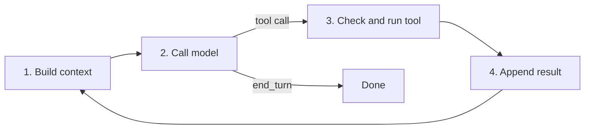

# 02 - Architecture

## The loop

The model never touches files. It replies with text or a tool call; the harness decides whether to run it.

1. **Build the context:** system prompt, tool definitions, project instructions, conversation so far.
2. **Call the model:** text or a structured tool call.
3. **Check and run the tool:** permission rules, ask the user, sandbox, then execute. All safety lives here ([03-safety.md](03-safety.md)).
4. **Append the result and loop.** A reply with no tool call ends the loop.

Every later feature refines one of these four stages. Each post names the stage it changes.

## Components

| Component | Contents |
| --- | --- |
| `saysno/loop.py` | The loop: stages 1-4 |
| `saysno/tools.py` | Tool definitions and implementations |
| `saysno/policy.py` | Permission rules (from M1: allow/ask list; grows in M4) |
| `saysno/cli.py` | Interactive REPL |
| `evals/` | Task set, runner, scorer ([04-evaluation.md](04-evaluation.md)) |
| `testbed/` | The planted-bug project |
| `tests/` | Unit tests and scripted-model tests |

Names are a starting point; the M1 commit may adjust them.

## L - Loop

| ID | Requirement | Priority | Milestone | Status |
| --- | --- | --- | --- | --- |
| L-01 | Python 3.12+; the Anthropic Python SDK is the only third-party runtime dependency | Must | M1 | Planned |
| L-02 | The loop implements the four stages above and ends when the model replies without a tool call | Must | M1 | Planned |
| L-03 | M1 agent is at most 200 non-blank, non-comment lines; CI enforces it at M1 and reports the count afterwards | Must | M1 | Planned |
| L-04 | The model and thinking setting are parameters: `claude-haiku-5-5` without thinking by default; `claude-opus-5-5` with adaptive thinking selectable | Must | M1 | Planned |
| L-05 | A scripted model replays a fixed sequence of replies, so the loop and tools are tested without the API | Must | M1 | Planned |
| L-06 | Every run writes a transcript (messages, tool calls, results, token usage) as JSON Lines | Must | M1 | Planned |
| L-07 | Each feature after M1 can be switched off, so the bare loop stays runnable for the final comparison | Must | M3 | Planned |

## T - Tools

| ID | Requirement | Priority | Milestone | Status |
| --- | --- | --- | --- | --- |
| T-01 | `read_file(path, offset, limit)`: numbered lines, a range at a time | Must | M1 | Planned |
| T-02 | `edit_file(path, old, new)`: exact-string replace; fails if `old` is absent or occurs more than once, and says which | Must | M1 | Planned |
| T-03 | `bash(command)`: runs in the task's working directory with a timeout; subject to S-area rules | Must | M1 | Planned |
| T-04 | `grep(pattern, path)`: matches with file and line number | Must | M1 | Planned |
| T-05 | Tool paths are confined to the task's working directory; a path outside it is an error, not a silent fix | Must | M1 | Planned |
| T-06 | Tool errors say what went wrong and what to try instead | Should | M2+ (from the failure log) | Planned |
| T-07 | `write_file` for new files only; refuses to overwrite | Could | from the failure log | Planned |

## C - Context and memory

Levels refer to the context and memory ladders in the [design note](https://github.com/billykong/billy-notes/blob/main/ai/saysno-design.md).

| ID | Requirement | Priority | Milestone | Status |
| --- | --- | --- | --- | --- |
| C-01 | Tool output over a size cap is truncated, with a notice saying so and how to read the rest (context level 2) | Must | M3 | Planned |
| C-02 | The system prompt steers toward `grep` and ranged reads over whole-file reads (context level 3) | Should | M3 | Planned |
| C-03 | Prompt layout keeps a stable prefix (system prompt, tools, instructions) for prompt caching; cache hits reported | Should | M3 | Planned |
| C-04 | Near a token threshold, older turns are replaced by a summary: goal, decisions, state, open problems (context level 5) | Must | M5 | Planned |
| C-05 | At least one recorded case where compaction loses a detail that mattered, with the post explaining it | Must | M5 | Planned |
| C-06 | A human-written instruction file in the task directory is loaded every run (memory level 4) | Must | M6 | Planned |
| C-07 | The agent may write and read a progress-notes file that survives compaction and restarts (memory level 5) | Must | M6 | Planned |
| C-08 | Clearing old tool results (context level 4) or subagents (level 6) | Could | from the failure log | Planned |
